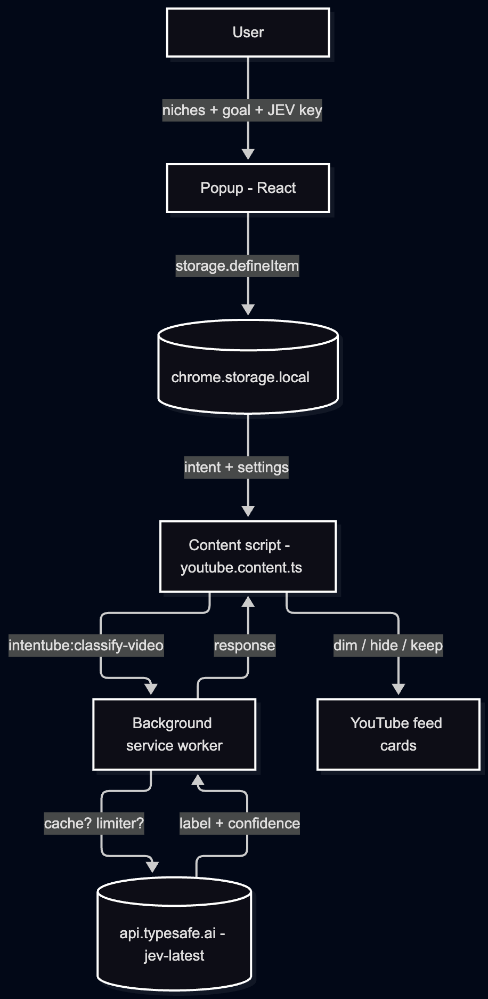
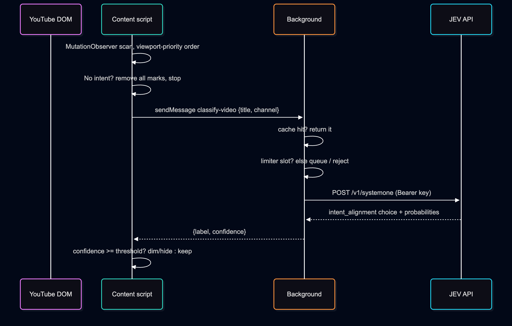
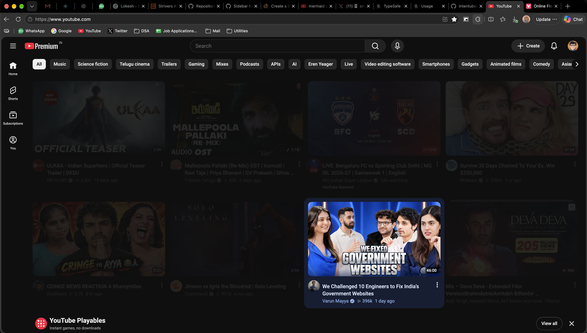

# Intentube

> Ask why you're on YouTube, dim everything that doesn't serve it.

Intentube is a Chrome extension (MV3) that keeps your YouTube feed on purpose. You pick the niches you care about (or type your own goal), paste your Typesafe AI JEV API key, and the extension dims or hides feed videos a classifier labels as distractions relative to your intent. No backend — everything runs in the extension.

## Features

- **Intent profile** — pick up to 5 of 20 niches, add a custom niche/goal with exclusions (280 chars max).
- **BYOK classification** — your own Typesafe AI JEV key (`jev-latest` model), stored only in the browser.
- **Dim or hide** — distractions fade to a configurable opacity or disappear entirely; hover brightens dimmed cards.
- **Shorts control** — optionally hide all Shorts/shelves without any intent set.
- **Confidence threshold** (50–99%, default 65%) — only filter when the model is sure enough.
- **Fail-open** — no intent set means no filtering; the feed stays untouched and the background asks you to open the popup.
- **Performance engineering** — SHA-256 classification cache (20k LRU entries, persisted), 3 concurrent JEV requests shared across tabs, viewport-priority scanning, skeleton placeholders while classifying.

## How it works

### Flow Chart


### Sequence Diagram


Key design points:

- **Single classifier boundary** — `utils/classifier/types.ts` defines the `Classifier` interface; callers use `classifyVideo()` (`utils/classifier/index.ts`), which Zod-validates input, output, and the raw JEV response. Impl swap = one object.
- **Background owns the network** — content scripts never hold the API key; they send `{title, channel}` via `runtime.sendMessage` and get back `{label, confidence}` or `{error}`. Sender is verified (`sender.id`, YouTube URL).
- **Stale-result guards** — per-card signatures, intent revisions, and retry-with-backoff (6 tries) handle YouTube recycling cards mid-request and intent changes mid-flight.
- **All external data is Zod-validated** — storage reads, messages, API responses, persisted cache entries.

## Project structure

```text
entrypoints/
  popup/            React UI: niches, custom goal, JEV key, thresholds, hide-Shorts, reset
  options/          Placeholder settings page (filter settings currently live in the popup)
  youtube.content.ts  Feed observer: scan, skeleton state, dim/hide, hover-preview block
  background.ts     Classifier gateway: message handler, cache, limiter, key/intent lookup
utils/
  intentStore.ts        Intent profile schema + storage (migrates legacy text intents)
  keyStore.ts           API key storage (local, never logged)
  filterSettings.ts     Threshold / display mode / dim amount / hide-Shorts + storage
  feedFilter.ts         shouldFilterDistraction(classification, threshold)
  classificationCache.ts  SHA-256 LRU cache, persisted, dedupes concurrent requests
  concurrencyLimiter.ts   Bounded parallel + queue limiter
  classificationLimits.ts MAX_CONCURRENT_CLASSIFICATIONS = 3
  classifier/           types.ts, index.ts (live JEV impl), classifier.test.ts
evaluation/           Live-API harness: jevDataset.ts (50 provisional cases), jev.test.ts
docs/screenshots/     README screenshots (see below)
```

## Setup

Prerequisites: **Node ≥ 22**. The default shell here may resolve Node 20, which fails `wxt prepare` — prefix every command:

```sh
export PATH="/opt/homebrew/bin:$PATH"
node -v   # expect v24+
```

```sh
pnpm install
pnpm dev        # HMR browser with the extension installed
pnpm compile    # tsc --noEmit
pnpm test       # unit suite (mocked network, no real requests)
pnpm build      # .output/chrome-mv3/
pnpm zip        # store-ready bundle
```

Load manually: `chrome://extensions` → Developer mode → Load unpacked → `.output/chrome-mv3/`.

Suggested order: `compile` → `test` → `build`.

## Usage

1. Click the toolbar icon. Paste your **JEV API key** (stored in `chrome.storage.local`, never leaves the browser except to `api.typesafe.ai`).
2. Pick up to **5 niches** and/or type a **custom niche or goal** (e.g. "Full songs and music videos, not movie scenes").
3. Tune **confidence threshold** (50–95%), **dim amount**, **dim vs hide**, and **Hide short videos**.
4. **Save**. The feed re-scans live via `storage.onChanged` — no reload needed.
5. **Reset to original feed** clears the intent (key stays saved) and restores every card.

Shorts-only mode: enable *Hide short videos* with no intent set — intent filtering stays off.

## Testcases

### Unit suite — `pnpm test` (hermetic, `fetch` stubbed, storage stubbed)

| File | Covers |
| ---- | ------ |
| `utils/classifier/classifier.test.ts` | Returns JEV choice + confidence; low-confidence passthrough for the threshold; request sends title + channel, no description; rejects malformed responses |
| `utils/feedFilter.test.ts` | Below/at/above threshold; never filters `relevant`; respects stricter thresholds |
| `utils/filterSettings.test.ts` | 65% + dim defaults; accepts supported ranges/modes; migrates settings missing the Shorts flag; rejects out-of-range thresholds and unknown modes |
| `utils/classificationCache.test.ts` | Persist + reuse; reload after recreate; per-intent entries; normalization (order/case/spacing); per-title and per-channel separation; request dedupe; no caching of failures; intent-change guard; invalid persisted data ignored; LRU eviction; 25-video batch (no 20-cap); p95 lookup < 50 ms |
| `utils/concurrencyLimiter.test.ts` | Never exceeds the concurrency limit; rejects when the queue is full |
| `utils/backgroundConcurrency.test.ts` | 3-request limit shared across tabs + same-video dedupe; queued request cancelled after reset; cache served when all slots busy |
| `utils/youtubeContent.test.ts` | Recycled Shorts card restored for regular videos; loading state under 3 concurrent requests; visible cards prioritized; direct loading→reveal/hide; settings reapplied without refetch; reset restores cards and ignores stale intent results |
| `utils/evaluationDataset.test.ts` | 50 examples; music/tech/education coverage; both labels present per intent |

### Live JEV evaluation — `pnpm eval:jev` (real API, costs time/money)

- Dataset: 50 provisional cases — 17 music, 17 technology, 16 education (`evaluation/jevDataset.ts`). **Review labels before citing metrics anywhere.**
- Reports accuracy, distraction precision/recall, and per-intent accuracy at the default 65% threshold. Read-only: changes neither classifier nor cache.
- Key source: `JEV_API_KEY` from the shell or `.env` (root first, `evaluation/.env` fallback). Both paths are gitignored — never commit keys, never log them.

## Privacy & permissions

- Manifest permissions: `storage` only, plus `host_permissions: https://api.typesafe.ai/*`.
- The JEV key lives in `chrome.storage.local` on your machine. It is sent only to the Typesafe API as a Bearer token, never logged, never committed (`.env`, `evaluation/.env` ignored).
- No backend, no analytics, no third parties besides the JEV endpoint.

## Screenshots

### Popup Screen


### Feed Dimmed

